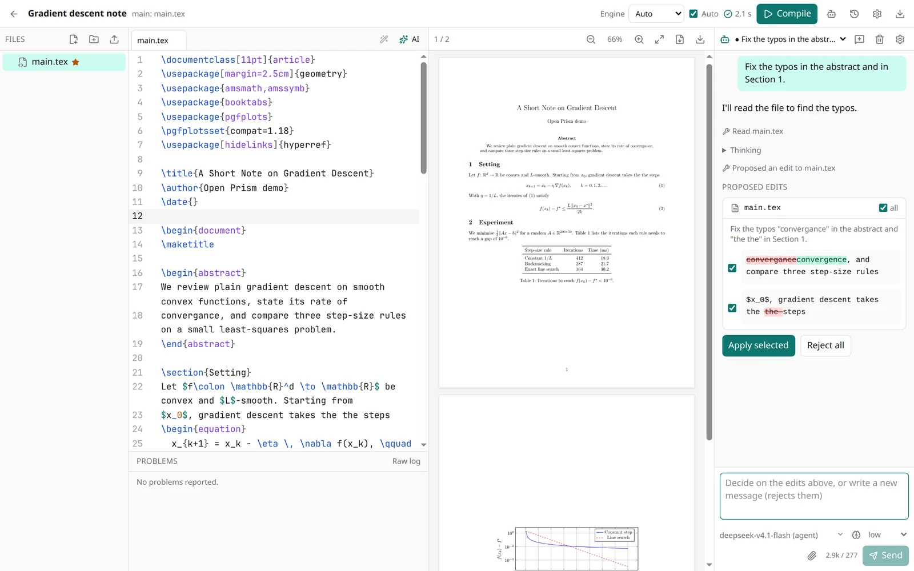
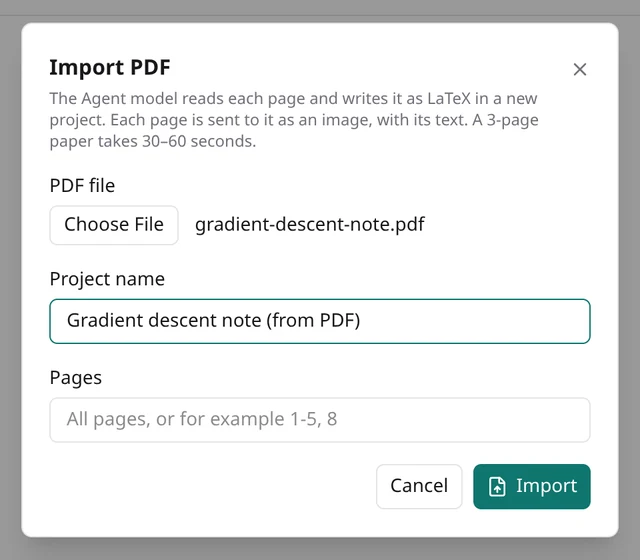
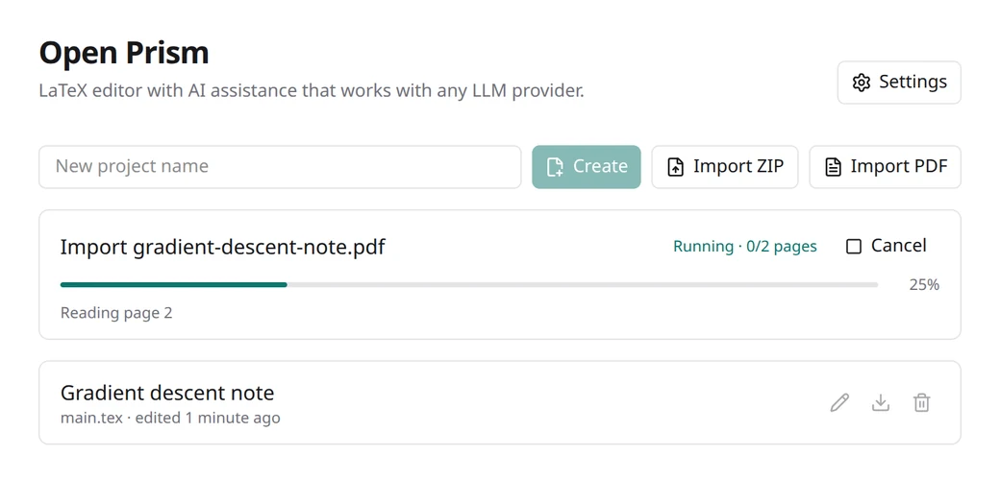
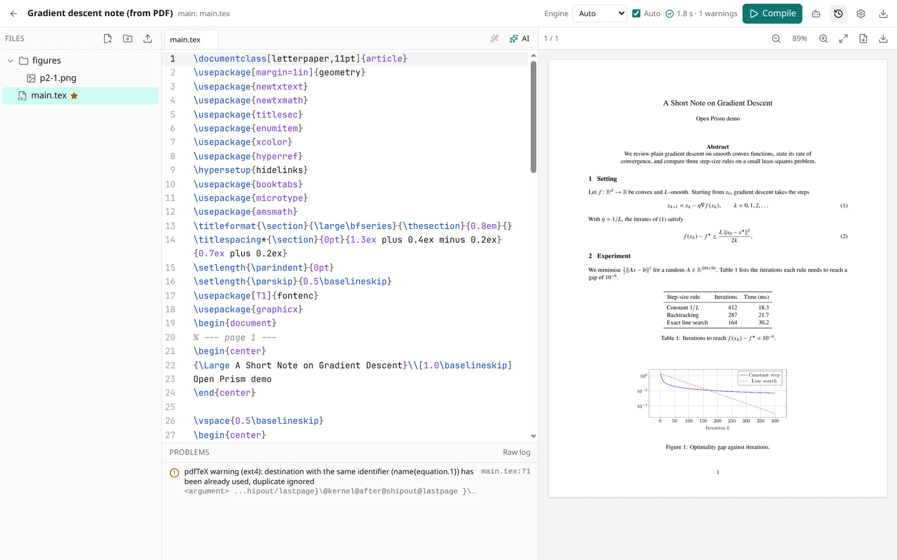
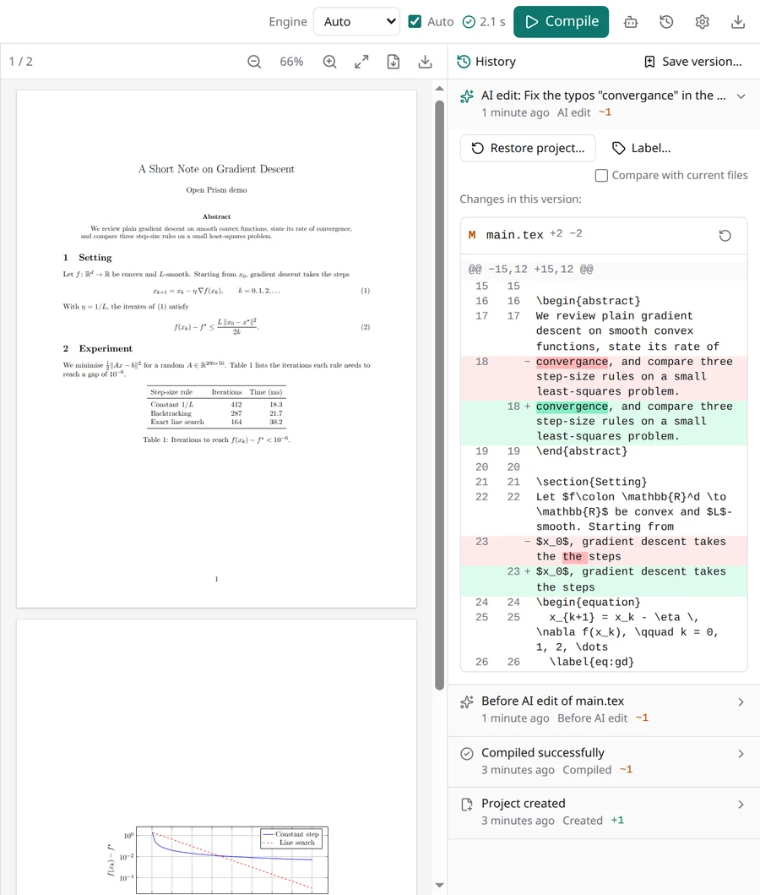
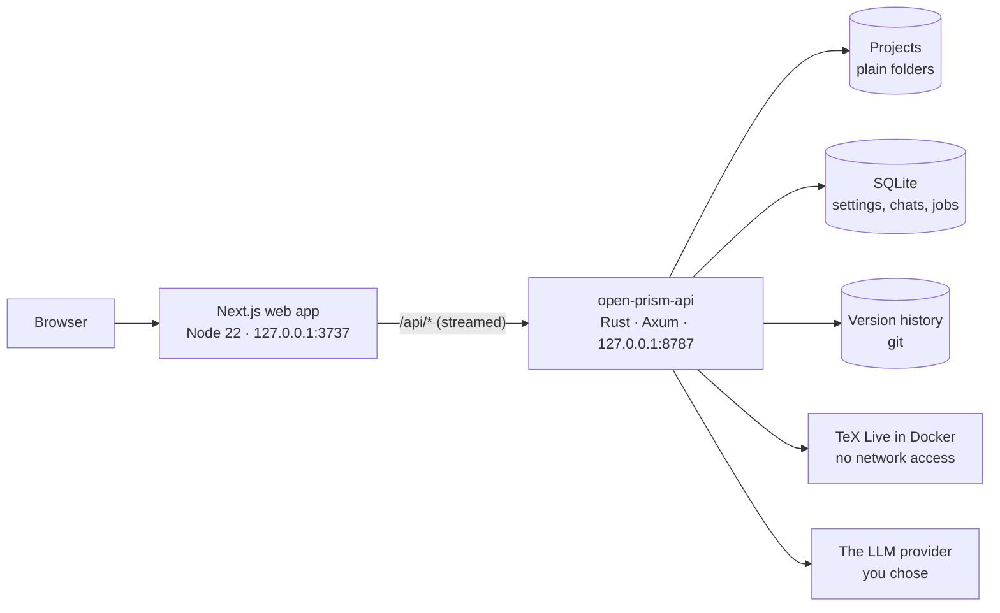

<div align="center">


# Open Prism

**The open-source LaTeX editor with an AI assistant.<br>Bring any LLM, and keep your work on your own machine.**

[](https://github.com/nttung245/open-prism/actions/workflows/ci.yml)
[](https://github.com/nttung245/open-prism/releases)
[](https://github.com/nttung245/open-prism/pkgs/container/open-prism)
[](LICENSE)

**English** · [Tiếng Việt](README.vi.md) · [简体中文](README.zh-CN.md)

[Quickstart](#quickstart) · [Features](#features) · [How it works](#how-it-works) · [Privacy](#privacy-and-security) · [Documentation](#documentation) · [Roadmap](#roadmap)



</div>

## Why Open Prism

OpenAI Prism, the AI writing environment for LaTeX, shuts down on **January 1, 2027**. Open Prism
is an open-source alternative that you run yourself:

- **Your choice of model.** OpenAI, Anthropic, Gemini, DeepSeek, Mistral, OpenRouter, Groq, xAI
  and OpenCode Go, or local models through Ollama, vLLM, LM Studio and llama.cpp.
- **Your files stay yours.** Projects are plain folders of `.tex` files on your disk. The app
  listens on `127.0.0.1` only. Nothing leaves your computer except the requests sent to the
  model provider you chose.
- **The AI proposes, you decide.** Every edit arrives as a diff that you accept or reject.
  Nothing is written before you decide, and every change lands in a version history that you
  can roll back.
- **Bring your projects with you.** Import ZIP exports from Prism, Overleaf and arXiv, or turn
  any PDF, even a scan, into an editable LaTeX project.

## Features

### Write and compile

A three-pane workspace with a file tree, a LaTeX editor and a live PDF preview.

- **Compilation** with latexmk (pdfLaTeX, XeLaTeX or LuaLaTeX, picked automatically) or
  Tectonic, on demand with `Ctrl+Enter` or after every save. Errors and warnings show in the
  editor and in a Problems list.
- **SyncTeX** both ways: click the PDF to jump to the source, or press `Ctrl+Alt+→` to find
  the line in the PDF.
- **Export:** download a project as ZIP or 7z, the whole PDF, or only some pages (`3-7, 10`).

### An assistant that works like a careful co-author

- **Agent with tools.** It reads your project (files, search, outline, compile log) and
  **proposes** edits as word-level diffs. Accepted changes go into the editor, so `Ctrl+Z`
  undoes them.
- **Fix with AI.** From the Problems list, it loops compile → fix → compile until the errors
  are gone.
- **Quick actions** on a selection: rewrite, shorten, fix grammar, translate, explain, or your
  own instruction.
- **Suggestions as you type.** The rest of a sentence, the next `\item` or a missing
  `\end{…}` appear in grey at the cursor. `Tab` accepts them.
- **Capture and ask.** Drag over a formula, table or figure in the PDF and ask about it.
- **Image to LaTeX.** Paste a picture of a formula, a table or handwriting, and get LaTeX that
  fits the spot.
- **Citations stay yours.** The assistant helps with wording and syntax, but never adds
  `\cite` commands or looks up papers for you.

### Turn any PDF into a LaTeX project

<table>
  <tr>
    <td width="40%"></td>
    <td width="60%"></td>
  </tr>
</table>

**Import PDF** has the model read each page as an image, together with the PDF's text layer
when there is one. It then rebuilds the document as LaTeX:

- **Layout:** a preamble that matches the original (paper size, margins, fonts, heading
  styles), with math, tables and lists rebuilt.
- **Figures** are cut out of the page into `figures/`.
- **Compile errors** are fixed by the assistant before you open the result.
- **Background job:** the import keeps going while you work on other projects, after you close
  the page, and even after a restart. A live progress line shows each page as it finishes.



### A safety net for every change



**Version history** saves a version when a project is created or imported, before and after
every AI edit, after successful compiles, and whenever you ask.

- **Compare:** each version shows a line diff, or how it differs from your current files.
- **Restore** one file or the whole project. Your current files are saved first, so a restore
  can be undone too.
- **Stored with git:** history is a plain git repository next to the project, never inside
  your exports.

<br clear="right">

## Quickstart

Open Prism runs on your own computer. Pick one way to install it:

| You have | Use | What you need |
|---|---|---|
| Linux (x64 or arm64) | [the prebuilt package](#linux-prebuilt-package) | Docker, for TeX Live |
| macOS, Windows or Linux | [the Docker image](#docker-macos-windows-linux) | Docker Desktop or Docker |
| Any machine with a toolchain | [a build from source](#build-from-source) | Rust, Node.js 22, pnpm, just, Docker |

### Linux: prebuilt package

Download `open-prism-<version>-linux-x64.tar.gz` (or `-arm64`) from
[Releases](https://github.com/nttung245/open-prism/releases), then:

```sh
docker pull texlive/texlive:latest   # TeX Live, once: a 2.6 GB download
tar -xzf open-prism-<version>-linux-x64.tar.gz
cd open-prism-<version>-linux-x64
./open-prism                         # starts Open Prism and opens the sign-in page
```

### Docker: macOS, Windows, Linux

Save [`compose.yaml`](compose.yaml) in a folder, then in that folder:

```sh
docker compose up -d              # downloads the image the first time, then starts Open Prism
docker compose logs open-prism    # shows the sign-in link
```

The image holds everything, TeX Live included, for amd64 and arm64 (Apple Silicon too).

### Build from source

```sh
git clone https://github.com/nttung245/open-prism.git && cd open-prism
just tex-pull   # TeX Live as a Docker image, once
just build      # release build of the API and the web app
just start      # runs both and prints a sign-in link
```

### Connect a model

1. Open **Settings** from the project list. Under **Add a provider**, pick the type, paste
   your API key and click **Add provider**. See [AI providers](#ai-providers) for where to get
   a key, or how to use a model on your own machine.
2. Click **Test connection**: it lists the provider's models.
3. Under **Models**, choose a model for **Agent** (the assistant) and, if you like, a quicker
   one for **Fast** (quick actions, suggestions, Image to LaTeX). Click **Save models**.
4. Create a project, compile it with `Ctrl+Enter`, and open the assistant with the robot
   button.

Installation details (checking downloads, the desktop menu entry, ports, backups) are in
[Installation in depth](#installation-in-depth).

## How it works



| Layer | Built with |
|---|---|
| Backend | Rust, Axum, Tokio, SQLite (sqlx), libgit2, [genai](https://github.com/jeremychone/rust-genai) for LLM providers, hayro and lopdf for PDF pages and text |
| Frontend | Next.js 16, React 19, TypeScript, CodeMirror 6, pdf.js, TanStack Query, Tailwind CSS 4 |
| TeX | The official TeX Live image, latexmk and SyncTeX; Tectonic or a native TeX Live also work |
| Quality | Rust and TypeScript unit tests, end-to-end tests in Chromium against a fake model, clippy, Biome and cargo-deny in CI on every pull request; release builds with verifiable build provenance |

- **One entry point.** The Rust API only listens on `127.0.0.1`. The Next.js server serves
  the pages and forwards `/api/*` to it through a streaming route.
- **Background jobs.** Long work, such as a PDF import, runs in steps whose state is kept in
  the database, so a job interrupted by a restart resumes where it stopped.
- **Fair use of the model.** Background requests share a gate that allows three at a time
  per provider and waits out rate limits, so chat and suggestions never queue behind a job.

## Privacy and security

- **Local only.** The API listens on `127.0.0.1`, and the web app does too, except inside the
  Docker image, whose port is published on the host's `127.0.0.1`. Sign-in uses a random
  access token created on first start.
- **What a provider receives** is only what each feature needs:
  - your messages and their images;
  - the files and compile log the assistant reads;
  - the selected text for quick actions, and the text around the cursor for suggestions;
  - for a PDF import, each page as an image with its text layer.
- **Keys** are stored in the local database and are never sent back to the browser.
- **Compilation** runs in a throwaway container without network access.
- **Releases** ship with SHA-256 checksums and GitHub build provenance attestations, for the
  packages and the Docker image.

## Project status

Early releases (0.3.x):
- Prebuilt Linux packages and a multi-arch Docker image are published with every release.
- macOS and Windows run through Docker; native builds there are not tested yet.
- See the [roadmap](#roadmap) and the [releases](https://github.com/nttung245/open-prism/releases).

---

# Documentation

- [Installation in depth](#installation-in-depth)
- [Feature reference](#feature-reference)
- [AI providers](#ai-providers)
- [Troubleshooting](#troubleshooting)
- [Configuration](#configuration)
- [Development](#development)

## Installation in depth

### Linux package

**You need:**
- Linux x64 or arm64 with glibc 2.35 or newer (Ubuntu 22.04, Debian 12, Fedora 36 or newer);
- [Docker](https://docs.docker.com/get-docker/) for TeX, usable by your user without `sudo`.

The package brings everything else, Node.js included. TeX Live is a 2.6 GB download and takes
about 9 GB on disk.

- **Starting:** your browser opens once Open Prism is ready, and the sign-in link is printed
  too.
- **Stopping:** press Ctrl+C or close the terminal window.
- **Application menu:** `./open-prism install-desktop` adds **Open Prism** to it. It runs in a
  terminal window; close the window to stop it. `./open-prism uninstall-desktop` removes it.
  If you move the folder, run `install-desktop` again.
- **Other commands:** `README.txt` in the folder lists them, such as other ports and
  `OPENPRISM_NO_BROWSER=1` for a machine without a screen.

To check the download, run this in the folder with the `.tar.gz` and `SHA256SUMS` from the same
release. The second command uses the [GitHub CLI](https://cli.github.com/) to check that GitHub
Actions built the package from this repository.

```sh
sha256sum -c SHA256SUMS --ignore-missing
gh attestation verify open-prism-<version>-linux-x64.tar.gz --repo nttung245/open-prism
```

Projects and settings live in `~/.local/share/open-prism`, not in the release folder, so a
newer release can replace the folder.

### Docker image

**You need:** [Docker](https://docs.docker.com/get-docker/), or Docker Desktop on macOS and
Windows.

The image is about 2.7 GB to download and 9.5 GB on disk, and runs on amd64 and arm64. Images
are published from version 0.2.0 on.

**Signing in.** Open the link that `docker compose logs open-prism` shows
(`http://127.0.0.1:3737/login?token=…`).
`docker compose exec open-prism open-prism print-token` prints the token again.

**Stopping and upgrading.** Stop it with `docker compose down`. Projects and settings stay in
the `open-prism-data` volume, so you can replace or upgrade the container:
`docker compose pull && docker compose up -d`.

Without compose:

```sh
docker run -d --name open-prism --init -p 127.0.0.1:3737:3737 -v open-prism-data:/data \
  ghcr.io/nttung245/open-prism:latest
docker logs open-prism             # shows the sign-in link
```

**Ports.** Keep `127.0.0.1:` in front of the port: without it, Docker opens Open Prism to your
whole network. For another port, change both sides and tell the app, as in
`-p 127.0.0.1:4000:4000 -e OPENPRISM_WEB_PORT=4000`.

**Backups.** Stop Open Prism, then copy the data out:
- with compose: `docker compose stop && docker compose cp open-prism:/data ./open-prism-backup`;
- without it: `docker cp open-prism:/data ./open-prism-backup`.

A folder of your own instead of the volume (`-v ./data:/data`) works only if the user with
uid 1000 can write to it.

**What is in the image.** It is the Linux release package on the official
[TeX Live image](https://hub.docker.com/r/texlive/texlive). Open Prism compiles inside the
container and never needs your Docker socket. The `latest` tag is the newest published release;
`<version>` tags never change.

### From source

Tested on Linux; macOS and Windows are not tested yet.

**You need:**
- [Git](https://git-scm.com/);
- [rustup](https://rustup.rs/), which installs the right Rust version on the first build;
- [Node.js](https://nodejs.org/) 22 or newer, and pnpm (run `corepack enable` once; Corepack
  ships with Node.js);
- [just](https://just.systems);
- [Docker](https://docs.docker.com/get-docker/) for TeX, usable by your user without `sudo`.

The first `just build` takes several minutes. Then open the link `just start` prints
(`http://127.0.0.1:3737/login?token=…`).

- **Other ports:** `OPENPRISM_PORT=8799 WEB_PORT=3799 just start`.
- **Without just:** after a build, `just start` is the same as
  `./target/release/open-prism-api serve --web web/.next/standalone`. See
  [Configuration](#configuration) for its options.

## Feature reference

### Projects and editor

- **Projects:** create, rename and delete; import a ZIP (Prism, Overleaf, arXiv) or a PDF;
  download one as ZIP or 7z.
- **Editor:** file tree, tabs, LaTeX highlighting and autosave. A file changed by another
  program reloads by itself. If you had unsaved edits too, you choose which version to keep.

### Compilation

latexmk (pdfLaTeX, XeLaTeX, LuaLaTeX) or Tectonic. Compile on demand with `Ctrl+Enter`, or
after every save. Errors and warnings appear in the editor and in a Problems list.

The engine is chosen automatically unless you pick one for the project:
- A `% !TEX program = …` line wins.
- Otherwise XeLaTeX is used when a `.tex` file of the project needs Unicode fonts (`fontspec`,
  …), or has Vietnamese text without the T5 encoding (`\usepackage[T5]{fontenc}` or
  `[vietnamese]{babel}`).
- Everything else uses pdfLaTeX.

### PDF preview

- **Keeps your place** when it reloads after a compile.
- **SyncTeX:** click a line of the PDF to jump to its source. `Ctrl+Alt+→` in the editor
  highlights the line in the PDF.
- **Download** the whole PDF, or only some pages: "Download pages…" takes a list such as
  `3-7, 10`, filled in with the page you are reading. Links between the pages you keep still
  work; bookmarks are dropped.

### AI assistant

Open it with the robot button.

- **Tools:** it reads the project with tools: files, search, outline and compile log.
- **Reviewed edits:** it **proposes** edits, shown as word-level diffs. You accept or reject
  each change. Accepted changes go into the editor, so `Ctrl+Z` undoes them, and nothing is
  written before you decide.
- **Fix with AI:** this button in the Problems list loops compile → fix → compile.

### Quick actions

The AI menu acts on the selected text: rewrite, shorten, fix grammar, translate, explain, or
your own instruction.

### Capture and ask

Drag over part of the PDF (a formula, a table, a figure). It goes to the assistant as an image,
with its page and the source line it comes from, ready for your question.

- `Esc` while dragging cancels.
- A message takes up to four images.
- The conversation's model has to read images (DeepSeek v4.1 Flash through OpenCode Go does).
  One that cannot shows the provider's error.

### Images in the chat

Besides PDF captures, you can add images to a message in three ways:
- paste an image into the message box, when the clipboard holds no text;
- drop image files on the assistant;
- pick them with the paperclip button.

PNG, JPEG and WebP are accepted:
- Images over 2,000 pixels on their longest side are scaled down before sending; your files
  are not changed.
- An image still over 5 MB is refused.
- The four-image limit of a message counts PDF captures too.

Images are kept in `<data dir>/attachments/<project id>/<conversation id>/`, outside the
project. Deleting the conversation or the project deletes them. They are sent to the
conversation's AI provider, like the text of the messages.

### Image to LaTeX

**Starting it:** paste an image into a `.tex` file (when the clipboard holds no text), drop an
image file on the editor, or choose "Image to LaTeX…" in the AI menu.

**What you get:** the fast model transcribes the formula, table, or printed or handwritten
text into LaTeX that fits the spot:
- an `equation` or `align` environment, or just the math when you are already inside one;
- a `tabular`;
- paragraphs in the language of the image.

**Inserting it:** a panel shows the LaTeX as it is written. The file does not change until you
click Insert. Insert puts the LaTeX where you pasted or dropped the image, even if you kept
typing meanwhile, as one change that `Ctrl+Z` undoes.

**What it leaves to you:**
- Packages the result needs that the main file does not load are named, never added.
- Citations come out as `[?]` for you to fill in.

The image is sent for that one request and is not stored.

### Suggestions as you type

Pause in a `.tex` file and the fast model proposes how to go on: the rest of the sentence, the
next `\item`, a missing `\end{…}`. The suggestion shows in grey at the cursor as the model
writes it, and follows along as you keep typing.

| Key | Does |
|---|---|
| `Tab` | Accepts the suggestion |
| `Ctrl+→` (`Alt+→` on macOS) | Takes one word |
| `Esc` | Dismisses it |
| `Alt+\` | Asks for one right away |

- **What is sent:** only the text around the cursor.
- **No citations:** a suggestion never contains one; references are yours to add.
- **Turning it off:** the wand button next to "AI" turns suggestions off.
- **Speed:** set the Fast role's reasoning to "off" in Settings for the quickest suggestions.
  How soon they appear depends mostly on how fast the provider starts answering.

### Import a PDF

**Import PDF** on the project list takes three things:
- the file, up to 300 pages and 200 MB;
- a project name, the file name by default;
- the pages: empty for all of them, or a list such as `1-5, 8`.

**What the Agent model does:**
- It reads each page as an image, with the PDF's text layer when there is one, so scans work
  too.
- It writes a preamble from the first page, so the result looks like the original: paper
  size, margins, a close font, heading style and lists.
- It cuts pictures out of the page into `figures/`.
- It puts the pages together, compiles them, and fixes compile errors (up to two rounds).

The result is a new project with a first version in its history. Citations stay as printed
text, never `\cite`.

**Following the import.** It runs in the background, and a list above your projects shows
each job with a progress line, live:
- Keep working in other projects meanwhile.
- **Cancel** a job, or **Retry** a failed one. Pages already copied are kept, so you can fix
  the key in Settings and retry.
- **Open project** when it is done.

The import keeps going if you close the page, and after a restart.

**Cost.** With DeepSeek v4.1 Flash through OpenCode Go, a 3-page paper took 30–60 seconds.
Each page is one request, plus one request for the preamble. A page request takes about 2–4k
input tokens (mostly the image) and 0.2–1.5k output tokens. The Agent's model has to read
images.

### Version history

Open it with the clock button.

**When a version is saved:**
- when the project is created or imported;
- before and after you accept AI edits;
- after a successful compile, at most every ten minutes;
- around every restore;
- when you click "Save version…", with a label.

**Comparing and restoring:**
- Each version shows the files it changed with line diffs, or how it differs from the current
  files.
- Restore one file or the whole project. The current files are saved first, so a restore can
  be undone too.

**On disk.** History lives outside the project, in `<data dir>/history/<project id>.git`, a
plain git repository, so exported ZIPs never contain it. Every file is recorded except:
- symbolic links;
- anything named `.git` (your own repository or submodules);
- files over 100 MB.

To look at it without Open Prism:

```sh
git --git-dir ~/.local/share/open-prism/history/<project id>.git log --stat
```

## AI providers

Add providers in **Settings**. Each one needs a type and, for cloud providers, an API key.

- **Base URL:** it is filled in; change it only to go through a proxy.
- **Models:** **Test connection** lists the provider's models, and you can also type a model
  name. Model names change often, so the table below does not list them.

| Type in Settings | API key | Notes |
|---|---|---|
| OpenAI | [platform.openai.com/api-keys](https://platform.openai.com/api-keys) | Called through the Responses API, so reasoning models can use tools at any reasoning level |
| Anthropic | [platform.claude.com/settings/keys](https://platform.claude.com/settings/keys) | |
| Google Gemini | [aistudio.google.com/apikey](https://aistudio.google.com/apikey) | Reasoning "off" turns thinking off; models that must think are asked again without it |
| OpenRouter | [openrouter.ai/settings/keys](https://openrouter.ai/settings/keys) | Model names look like `vendor/model` |
| DeepSeek | [platform.deepseek.com/api_keys](https://platform.deepseek.com/api_keys) | |
| Mistral | [admin.mistral.ai/organization/api-keys](https://admin.mistral.ai/organization/api-keys) | |
| Groq | [console.groq.com/keys](https://console.groq.com/keys) | |
| xAI | [console.x.ai](https://console.x.ai/team/default/api-keys) | |
| OpenCode Go | [opencode.ai/console](https://opencode.ai/console), with a Go subscription | A gateway to open models. Open Prism is developed with `deepseek-v4.1-flash` there (November 2026), which also reads images |
| Ollama | none | Models on your machine; see [Local models](#local-models) |
| OpenAI-compatible (vLLM, LM Studio, …) | only if the server asks for one | Base URL required, e.g. `http://127.0.0.1:8000/v1` |

Links checked on 2026-11-20.

### Roles and reasoning

- **Agent** answers the chat and runs "Fix with AI". It reads the project with tools. A model
  that cannot call tools is detected, and it edits through SEARCH/REPLACE blocks instead.
- **Fast** runs quick actions on a selection, suggestions as you type and Image to LaTeX.
  Left on "Same as agent", these use the agent's model.
- **Reasoning** (default, off, low, medium, high, max) is set per role, and per conversation
  in the assistant:
  - "Default" sends no level.
  - Set Fast to "off" for quick suggestions.
  - When a model refuses the chosen level, the request is sent once more, with the nearest
    level the provider lists as supported, or with no level. For example, OpenAI's `gpt-5.5`
    tops out at "xhigh". That costs one extra round trip per request, so pick a level the
    model has.
- **Images** (PDF captures, images in the chat, Image to LaTeX, PDF import) need a model that
  reads images. One that cannot shows the provider's error.
- **PDF import** uses the Agent's model with reasoning off while it copies pages, because
  thinking spends the output tokens a page needs.

### What is sent, and where keys are kept

The provider receives what each feature needs:
- your messages, with their images;
- the files and compile log the assistant reads with its tools;
- the selected text, for quick actions;
- the text around the cursor, for suggestions;
- for a PDF import, each page as an image with its text layer, then the compile errors of the
  result with its preamble.

Keys are stored in the database in the data dir (`open-prism.db`, see
[Where is my data](#where-is-my-data)) and are never sent back to the browser.

### Local models

With Ollama in Docker:

```sh
docker run -d --name ollama -p 127.0.0.1:11434:11434 -e OLLAMA_CONTEXT_LENGTH=16384 \
  -v ollama:/root/.ollama ollama/ollama
docker exec ollama ollama pull qwen3:4b
```

Then add an *Ollama* provider in Settings, with the base URL `http://127.0.0.1:11434`. Set
`OLLAMA_CONTEXT_LENGTH`: Ollama's default context of 4096 tokens silently cuts off the project
context and the tool descriptions.

Other local servers use the *OpenAI-compatible* type, with the base URL ending in `/v1`:

| Server | Base URL by default | Tool calling |
|---|---|---|
| [vLLM](https://docs.vllm.ai/) | `http://127.0.0.1:8000/v1` | Start it with `--enable-auto-tool-choice --tool-call-parser <parser for your model>` |
| [LM Studio](https://lmstudio.ai/docs/developer/openai-compat) | `http://127.0.0.1:1234/v1` | Start the server in the Developer tab or with `lms server start` |
| [llama.cpp](https://github.com/ggml-org/llama.cpp/tree/master/tools/server) `llama-server` | `http://127.0.0.1:9931/v1` (older builds: port 8080) | Needs `--jinja`, on by default |

Without tool calling, the assistant still works through SEARCH/REPLACE blocks.

## Troubleshooting

**"port … on 127.0.0.1 is already in use".** Another program holds the port, often an Open
Prism still running.
- Stop it, or pick other ports: `--port` for the API (8787) and `--web-port` for the web app
  (3737), as in `./open-prism --port 8799 --web-port 3799`. With `just start`, set
  `OPENPRISM_PORT` and `WEB_PORT`.
- With `--open`, which `./open-prism` uses, an Open Prism already running on those ports is
  not an error: the sign-in page just opens again.
- If `open-prism-api` was killed outright (`kill -9`), its web app keeps running: stop the
  leftover `node server.js`.

**"the web app needs Node.js 22 or newer".** Install a newer Node.js, or point to one with
`--node /path/to/node` (or `OPENPRISM_NODE`).

**"No TeX engine found" on the project list.** The TeX engine is looked for when Open Prism
starts, so fix the cause and start it again:
- Docker is not running: start it.
- The image is missing: run `just tex-pull`.
- `docker` needs `sudo`: add your user to the `docker` group
  (`sudo usermod -aG docker $USER`), then log out and back in.
- The log line "TeX Live image unavailable" gives Docker's reason.

A native TeX Live (`latexmk`) or [Tectonic](https://tectonic-typesetting.github.io/) works too.

**Lost the sign-in link.** Print the token again, then paste it on the `/login` page, or open
`http://127.0.0.1:3737/login?token=<token>`:
- in the release folder: `./open-prism print-token`;
- with Docker: `docker compose exec open-prism open-prism print-token`;
- in a source build: `./target/release/open-prism-api print-token`, with the same
  `--data-dir` if you use one.

**The browser does not open.** `./open-prism` opens the sign-in page with `$BROWSER` if it is
set, otherwise `xdg-open`. If neither works, the log says "cannot open the browser" and Open
Prism keeps running: open the printed link yourself.

**Letters missing in the PDF (Vietnamese and other accented text).** With the engine on Auto,
Open Prism picks XeLaTeX for Vietnamese text unless the T5 encoding is set up. If a document
still loses letters, choose XeLaTeX or LuaLaTeX in the engine menu, or load the right
`fontenc` and `babel` options for pdfLaTeX.

**The AI says "rate limited".** The provider refused the request for quota or rate reasons,
and its own message follows. A monthly spending cap, for example, does not lift by waiting.

### Where is my data

Everything is in one folder:

| Setup | Folder |
|---|---|
| Linux | `~/.local/share/open-prism` |
| macOS and Windows | the platform's local data folder |
| Docker image | `/data`, in the `open-prism-data` volume |
| Any, with `--data-dir` (`OPENPRISM_DATA_DIR`) | the folder you give |

It holds:

| Path | What it holds | In a backup |
|---|---|---|
| `projects/` | one plain folder per project | yes |
| `history/` | version history | yes |
| `attachments/` | images sent to the assistant | yes |
| `open-prism.db` | settings, provider keys, conversations, background jobs | yes |
| `access-token` | the sign-in token | yes |
| `jobs/` | working files of background jobs | only while a job is unfinished |
| `build/`, `runs/`, `cache/`, `tmp/` | compile output and caches | no |

To back up, stop Open Prism and copy the folder.

## Configuration

| Variable | Used by | Default |
|---|---|---|
| `OPENPRISM_DATA_DIR` | API | platform data dir, e.g. `~/.local/share/open-prism` |
| `OPENPRISM_PORT` | API | `8787` |
| `OPENPRISM_ACCESS_TOKEN` | API | read from / created in `<data dir>/access-token` |
| `OPENPRISM_TEX_IMAGE` | API, `just tex-pull` | `texlive/texlive:latest` (`none` disables Docker) |
| `OPENPRISM_API_URL` | web (set by `serve --web`) | `http://127.0.0.1:8787` |
| `OPENPRISM_WEB_PORT` | `serve --web` | `3737` |
| `OPENPRISM_WEB_HOST` | `serve --web` | `127.0.0.1` (`0.0.0.0` in the Docker image) |
| `OPENPRISM_NODE` | `serve --web` | `node` from `PATH` |
| `OPENPRISM_OPEN` | `serve --web` | off (`true` is the same as `--open`) |
| `OPENPRISM_NO_BROWSER` | `./open-prism` in a release | unset (`1` leaves out `--open`) |
| `WEB_PORT` | `just dev` / `just start` | `3737` |

Most have a flag too: `--data-dir`, `--port` and `--tex-image`, and after `serve`,
`--web-port`, `--web-host`, `--node` and `--open`. `open-prism-api --help` lists them.

**`--web-host`** takes `127.0.0.1` (this computer only) or `0.0.0.0` (every address). Use
`0.0.0.0` only in a container whose port is published on the host's `127.0.0.1`, as the
Docker image does. The API always listens on `127.0.0.1`.

**`serve --web`:**
- **Startup:** it checks for Node.js, the build, and that both ports are free. It then starts
  the web app and prints the sign-in link once the web app is ready.
- **Log:** the web app's output shows up in the log, marked `web`.
- **Crashes:** if the web app crashes it is restarted. After three crashes within a minute,
  everything stops with an error.
- **Stopping:** Ctrl+C, SIGTERM, or closing the terminal (SIGHUP) stops both.
- **API only:** without `--web`, only the API runs.

**`--open`:**
- The sign-in link also opens in the browser: `$BROWSER`, otherwise `xdg-open`, `open` on
  macOS or `start` on Windows.
- If an Open Prism is already running on those ports, `serve --open` opens its sign-in page
  and exits instead of failing.
- The `open-prism` script of a release runs `serve --web` with the bundled web app and Node.js,
  and adds `--open` unless `OPENPRISM_NO_BROWSER=1`.

**Signing in.** On first start, the API creates a random access token in
`<data dir>/access-token` (mode 0600). The sign-in link carries it, and the `/login` page also
takes it pasted. Scripts can send it as `Authorization: Bearer <token>`.

## Development

**Requirements:**
- Rust 1.98, installed automatically from `rust-toolchain.toml`;
- Node.js 22+, pnpm 12 and [just](https://just.systems);
- for TeX: `just tex-pull` downloads the official
  [TeX Live image](https://hub.docker.com/r/texlive/texlive) (every package). Compilation runs
  in a throwaway container without network access. A native TeX Live (`latexmk`) or
  [Tectonic](https://tectonic-typesetting.github.io/) installation works too.

```sh
just dev                # API + web app in development mode on 127.0.0.1, prints a sign-in link
just test               # Rust and TypeScript tests, type check
just test docker        # also compile real documents in the TeX Live container
just test-live          # call the real OpenAI and Gemini APIs (keys from .env; a few cents)
just e2e                # end-to-end tests in Chromium on the built app (Playwright)
cargo test -p openprism-ai --test ollama -- --ignored --nocapture   # against a local Ollama
just lint               # what CI runs
just gen-types          # regenerate web/lib/api/types after changing API types
just package            # release package for this machine in target/dist, then run it once
```

**Repository layout:**

| Path | What |
|---|---|
| `crates/core` | Projects, compilation, log parsing, SyncTeX, outline, history, PDF pages (no HTTP) |
| `crates/ai` | Providers, model roles, agent loop, tools, patch protocol |
| `crates/literature` | arXiv / Crossref / OpenAlex search, DOI → BibTeX; not used by the app at present |
| `crates/server` | `open-prism-api`: the Axum HTTP API and background jobs |
| `web` | Next.js app; `web/lib/api/types` is generated from Rust with `ts-rs` |

**Testing:**
- **Without keys:** CI tests the AI layer against fake providers (wiremock), so it needs no
  keys.
- **`just test-live`** reads `OPENAI_API_KEY` and `GOOGLE_AI_API_KEY` from a `.env` file at the
  repository root (git ignores it) or from the environment, and skips a provider without a
  key.
- **`just e2e`** builds the web app and a debug API, then runs `web/e2e` in Chromium against a
  fake OpenAI-compatible model that the tests run themselves:
  - sign in, add a provider, import a ZIP, edit, compile, and accept an edit the model
    proposes;
  - import a PDF, with and without the live event stream.

  It uses ports 3798, 8798 and 8797 (`E2E_WEB_PORT`, `E2E_API_PORT`, `E2E_MODEL_PORT`) and a
  fresh data dir in `web/test-results/`. The server log, traces and screenshots of a failed run
  stay there. Run `pnpm exec playwright install chromium` in `web/` once first.

### Releasing

The [Release workflow](.github/workflows/release.yml) builds and checks everything first:
- **Packages:** one for Linux x64 and one for arm64, on Ubuntu 22.04. Each holds the API, the
  standalone web app, the official Node.js (`scripts/package-release.sh` pins its version and
  SHA-256) and the [`open-prism` script](packaging/open-prism).
- **Package check:** it runs each package once (`scripts/smoke-release.sh`): start, the web app
  and the API answer, a clean stop. `just package` does the same for your machine.
- **Images:** from each package it builds the Docker image ([`Dockerfile`](Dockerfile): the
  package on the official TeX Live image, pinned by digest).
- **Image check:** it runs each image on its platform (`scripts/smoke-image.sh`): sign in,
  compile the article template to a PDF, the health check, a clean `docker stop`, and the data
  still there in a new container. `just image` does the same for your machine.

To release:

1. Set the new `version` in `Cargo.toml` (`[workspace.package]`).
   - Check for a newer Node.js 22 release with security fixes. If there is one, update
     `NODE_VERSION` and both checksums in `scripts/package-release.sh`.
   - For a newer TeX Live in the image, set the digest of `BASE` in `Dockerfile` to the one
     `docker pull texlive/texlive:latest` prints.
2. Merge to `main`.
3. Run the workflow by hand (Actions → Release → Run workflow). It builds and tests both
   packages and both images without releasing or pushing anything. Pull requests that change
   the packaging or the image run it too.
4. Push the tag: `git tag v<version> && git push origin v<version>`. The workflow refuses a tag
   that differs from `Cargo.toml`. When both packages and both images pass, it:
   - pushes the image as `ghcr.io/nttung245/open-prism:<version>`, plus `<version>-amd64` and
     `<version>-arm64`;
   - makes a **draft** release with the packages, `SHA256SUMS` and build provenance
     attestations. The image has one too: `gh attestation verify
     oci://ghcr.io/nttung245/open-prism:<version> --repo nttung245/open-prism`.
5. Look over the draft on the Releases page, then publish it. Publishing moves the image's
   `latest` tag to this version. After the first image ever pushed, check that
   `docker pull ghcr.io/nttung245/open-prism:<version>` works without signing in. If not, make
   the `open-prism` package public in its settings on GitHub.

## Roadmap

- [x] **M0 Bootstrap**: workspace, API skeleton, access-token sign-in, API proxy, CI
- [x] **M1 Editor and compilation**: projects, ZIP import/export, CodeMirror editor,
      latexmk/Tectonic compilation, error list, PDF preview, SyncTeX
- [x] **M2 AI**: provider settings, chat with project context, reviewed edits,
      "fix compile errors", fallback for models without tool calling
- [x] **M3 Writing help**: version history, suggestions as you type, capture and ask
      about the PDF, images in the chat, image and handwriting to LaTeX
- [x] **M4 Release**: one-command run, user docs, prebuilt Linux packages, Docker image
- [x] **PDF import**: background jobs, and importing a PDF (scanned too) as a LaTeX project,
      the Agent reading each page

## Contributing

Issues and pull requests are welcome.
- **Before a pull request,** run `just lint` and `just test`. Add `just e2e` when you change
  the web app.
- **Commits** follow [Conventional Commits](https://www.conventionalcommits.org/), for example
  `feat(web): …` or `fix(server): …`.
- **Every pull request** runs the same checks in CI: Rust, Web, E2E and cargo-deny.

## License

[Apache License 2.0](LICENSE). Third-party notices are in [NOTICE](NOTICE).
