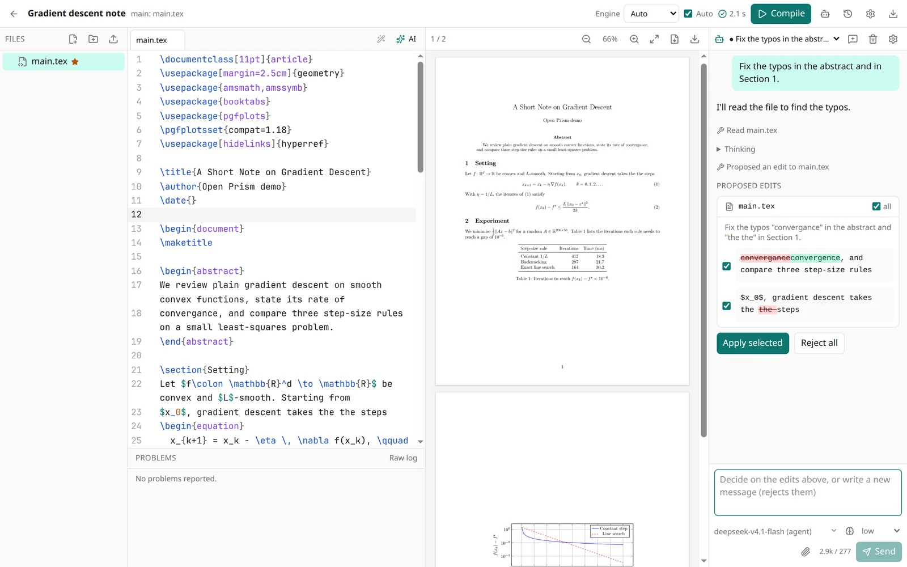
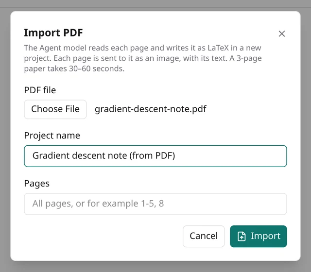
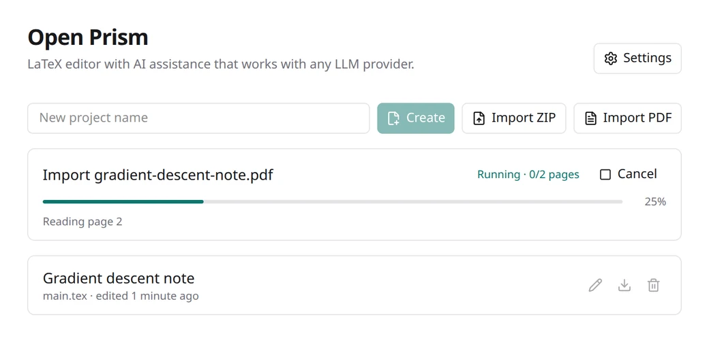
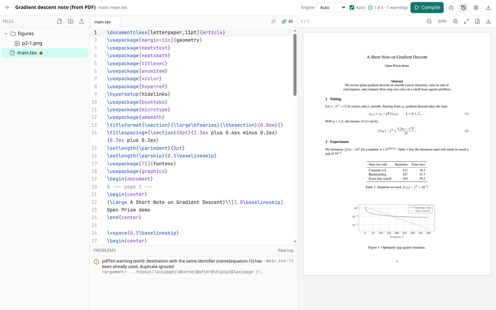
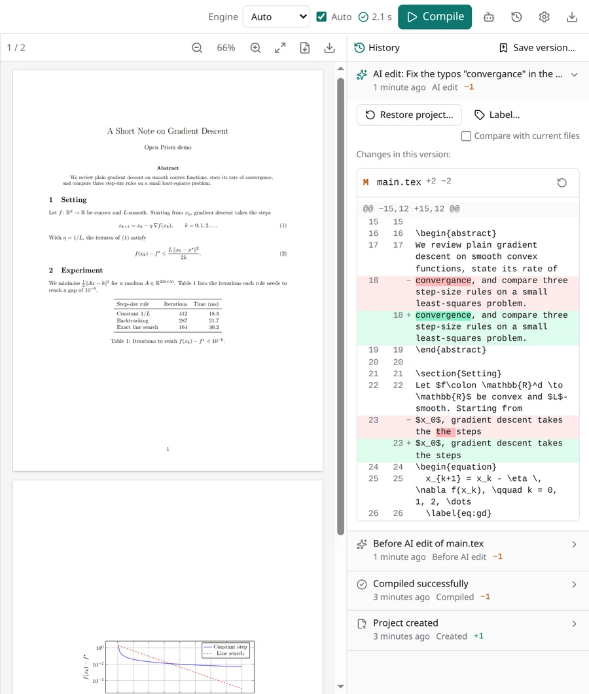
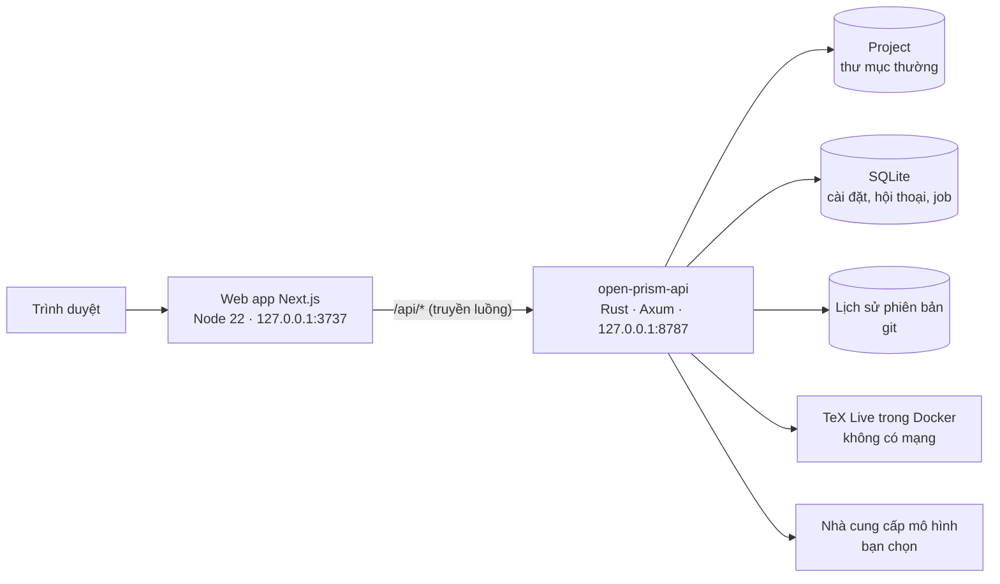

<div align="center">


# Open Prism

**Trình soạn LaTeX mã nguồn mở có trợ lý AI.<br>Dùng mô hình ngôn ngữ nào cũng được, mọi dữ liệu nằm trên máy của bạn.**

[](https://github.com/nttung245/open-prism/actions/workflows/ci.yml)
[](https://github.com/nttung245/open-prism/releases)
[](https://github.com/nttung245/open-prism/pkgs/container/open-prism)
[](LICENSE)

[English](README.md) · **Tiếng Việt** · [简体中文](README.zh-CN.md)

[Bắt đầu nhanh](#bắt-đầu-nhanh) · [Tính năng](#tính-năng) · [Cách hoạt động](#cách-hoạt-động) · [Quyền riêng tư](#quyền-riêng-tư-và-bảo-mật) · [Tài liệu](#tài-liệu) · [Lộ trình](#lộ-trình)



</div>

## Vì sao có Open Prism

OpenAI Prism, môi trường viết LaTeX có AI của OpenAI, sẽ ngừng hoạt động vào **ngày 1/1/2027**.
Open Prism là bản thay thế mã nguồn mở mà bạn tự chạy:

- **Bạn tự chọn mô hình.** OpenAI, Anthropic, Gemini, DeepSeek, Mistral, OpenRouter, Groq, xAI
  và OpenCode Go, hoặc mô hình chạy ngay trên máy qua Ollama, vLLM, LM Studio và llama.cpp.
- **File vẫn là của bạn.** Mỗi project là một thư mục `.tex` bình thường trên ổ đĩa, và ứng
  dụng chỉ lắng nghe ở `127.0.0.1`. Không có gì rời khỏi máy, ngoài các yêu cầu gửi tới nhà
  cung cấp mô hình mà bạn chọn.
- **AI đề xuất, bạn quyết định.** Mọi chỉnh sửa hiện ra dưới dạng diff để bạn chấp nhận hay từ
  chối. Không có gì được ghi trước khi bạn quyết, và mọi thay đổi đều vào lịch sử phiên bản để
  có thể quay lại.
- **Mang theo project cũ.** Nhập file ZIP xuất từ Prism, Overleaf và arXiv, hoặc biến bất kỳ
  PDF nào, kể cả bản scan, thành một project LaTeX chỉnh sửa được.

## Tính năng

### Soạn và biên dịch

Không gian làm việc ba khung: cây file, trình soạn LaTeX và bản xem trước PDF cập nhật liên tục.

- **Biên dịch** bằng latexmk (pdfLaTeX, XeLaTeX hoặc LuaLaTeX, tự chọn) hoặc Tectonic: bấm
  `Ctrl+Enter`, hoặc tự biên dịch sau mỗi lần lưu. Lỗi và cảnh báo hiện ngay trong trình soạn
  và trong danh sách Problems.
- **SyncTeX hai chiều:** bấm vào PDF để nhảy tới dòng nguồn, hoặc bấm `Ctrl+Alt+→` để tìm dòng
  đó trong PDF.
- **Xuất file:** tải project dạng ZIP hoặc 7z, tải cả PDF, hoặc chỉ một số trang (`3-7, 10`).

### Trợ lý làm việc như một đồng tác giả cẩn thận

- **Agent có công cụ.** Trợ lý đọc project của bạn (file, tìm kiếm, mục lục, log biên dịch) và
  **đề xuất** chỉnh sửa dưới dạng diff theo từng từ. Thay đổi đã chấp nhận đi vào trình soạn,
  nên `Ctrl+Z` hoàn tác được.
- **Fix with AI.** Từ danh sách Problems, trợ lý lặp biên dịch → sửa → biên dịch cho tới khi
  hết lỗi.
- **Thao tác nhanh** trên đoạn đang chọn: viết lại, rút gọn, sửa ngữ pháp, dịch, giải thích,
  hoặc theo yêu cầu riêng của bạn.
- **Gợi ý khi đang gõ.** Phần còn lại của câu, `\item` tiếp theo hay một `\end{…}` còn thiếu
  hiện bằng chữ xám ở con trỏ. Bấm `Tab` để nhận.
- **Chụp và hỏi.** Kéo chọn một công thức, bảng hay hình trong PDF rồi đặt câu hỏi về nó.
- **Ảnh thành LaTeX.** Dán ảnh chụp công thức, bảng hay chữ viết tay để nhận LaTeX vừa khớp chỗ
  đang soạn.
- **Trích dẫn là việc của bạn.** Trợ lý giúp câu chữ và cú pháp, nhưng không bao giờ tự thêm
  lệnh `\cite` hay tự tìm bài báo cho bạn.

### Biến PDF bất kỳ thành project LaTeX

<table>
  <tr>
    <td width="40%"></td>
    <td width="60%"></td>
  </tr>
</table>

**Import PDF** cho mô hình đọc từng trang dưới dạng ảnh, kèm lớp chữ của PDF nếu có, rồi dựng
lại tài liệu bằng LaTeX:

- **Bố cục:** preamble giống bản gốc (khổ giấy, lề, font, kiểu tiêu đề mục), cùng công thức,
  bảng và danh sách được dựng lại.
- **Hình** được cắt khỏi trang và lưu vào `figures/`.
- **Lỗi biên dịch** được trợ lý sửa trước khi bạn mở kết quả.
- **Chạy nền:** việc nhập vẫn tiếp tục trong lúc bạn làm project khác, sau khi bạn đóng trang,
  và cả sau khi khởi động lại. Một thanh tiến độ cập nhật trực tiếp theo từng trang.



### Lưới an toàn cho mọi thay đổi



**Lịch sử phiên bản** lưu một phiên bản khi project được tạo hoặc nhập, trước và sau mỗi lần AI
sửa, sau mỗi lần biên dịch thành công, và bất cứ khi nào bạn muốn.

- **So sánh:** mỗi phiên bản có diff theo dòng, hoặc so với các file hiện tại.
- **Khôi phục** một file hay cả project. File hiện tại được lưu lại trước, nên việc khôi phục
  cũng hoàn tác được.
- **Lưu bằng git:** lịch sử là một kho git bình thường đặt cạnh project, không bao giờ lẫn vào
  file bạn xuất ra.

<br clear="right">

## Bắt đầu nhanh

Open Prism chạy ngay trên máy của bạn. Chọn một cách cài:

| Bạn dùng | Cách cài | Cần có |
|---|---|---|
| Linux (x64 hoặc arm64) | [gói dựng sẵn](#linux-gói-dựng-sẵn) | Docker, để chạy TeX Live |
| macOS, Windows hoặc Linux | [image Docker](#docker-macos-windows-linux) | Docker Desktop hoặc Docker |
| Máy có sẵn bộ công cụ lập trình | [build từ mã nguồn](#build-từ-mã-nguồn) | Rust, Node.js 22, pnpm, just, Docker |

### Linux: gói dựng sẵn

Tải `open-prism-<version>-linux-x64.tar.gz` (hoặc `-arm64`) ở trang
[Releases](https://github.com/nttung245/open-prism/releases), rồi chạy:

```sh
docker pull texlive/texlive:latest   # TeX Live, chỉ cần một lần: tải khoảng 2,6 GB
tar -xzf open-prism-<version>-linux-x64.tar.gz
cd open-prism-<version>-linux-x64
./open-prism                         # khởi động Open Prism và mở trang đăng nhập
```

### Docker: macOS, Windows, Linux

Lưu file [`compose.yaml`](compose.yaml) vào một thư mục, rồi chạy trong thư mục đó:

```sh
docker compose up -d              # lần đầu sẽ tải image, sau đó khởi động Open Prism
docker compose logs open-prism    # hiện link đăng nhập
```

Image chứa sẵn mọi thứ, kể cả TeX Live, cho cả amd64 và arm64 (chạy được trên Apple Silicon).

### Build từ mã nguồn

```sh
git clone https://github.com/nttung245/open-prism.git && cd open-prism
just tex-pull   # TeX Live dạng image Docker, chỉ cần một lần
just build      # build bản release của API và web app
just start      # chạy cả hai và in ra link đăng nhập
```

### Kết nối mô hình

1. Mở **Settings** từ danh sách project. Ở mục **Add a provider**, chọn loại provider, dán API
   key rồi bấm **Add provider**. Xem [AI providers](README.md#ai-providers) (tiếng Anh) để biết
   lấy key ở đâu, hoặc cách dùng mô hình chạy trên máy.
2. Bấm **Test connection** để xem danh sách mô hình của provider.
3. Ở mục **Models**, chọn một mô hình cho **Agent** (trợ lý) và, nếu muốn, một mô hình nhanh
   hơn cho **Fast** (thao tác nhanh, gợi ý khi gõ, ảnh thành LaTeX). Bấm **Save models**.
4. Tạo một project, biên dịch bằng `Ctrl+Enter`, và mở trợ lý bằng nút hình robot.

Chi tiết cài đặt (kiểm tra file tải về, thêm vào menu ứng dụng, đổi cổng, sao lưu) có ở
[Installation in depth](README.md#installation-in-depth) (tiếng Anh).

## Cách hoạt động



| Tầng | Công nghệ |
|---|---|
| Backend | Rust, Axum, Tokio, SQLite (sqlx), libgit2, [genai](https://github.com/jeremychone/rust-genai) cho các provider LLM, hayro và lopdf để dựng trang và đọc chữ trong PDF |
| Frontend | Next.js 16, React 19, TypeScript, CodeMirror 6, pdf.js, TanStack Query, Tailwind CSS 4 |
| TeX | Image TeX Live chính thức, latexmk và SyncTeX; Tectonic hoặc TeX Live cài trên máy cũng dùng được |
| Chất lượng | Unit test Rust và TypeScript, test end-to-end trên Chromium với một mô hình giả, clippy, Biome và cargo-deny chạy trong CI ở mọi pull request; bản phát hành có chứng nhận nguồn gốc kiểm chứng được |

- **Một cổng vào duy nhất.** API Rust chỉ lắng nghe ở `127.0.0.1`. Server Next.js phục vụ giao
  diện và chuyển tiếp `/api/*` sang API qua một route truyền luồng.
- **Job chạy nền.** Việc dài như nhập PDF chạy theo từng bước, trạng thái lưu trong cơ sở dữ
  liệu, nên một job bị ngắt do khởi động lại sẽ chạy tiếp từ chỗ dừng.
- **Dùng mô hình công bằng.** Các yêu cầu chạy nền đi qua một cổng chung, cho phép tối đa ba yêu
  cầu cùng lúc với mỗi provider và chờ khi bị giới hạn tần suất. Nhờ vậy chat và gợi ý không bao
  giờ phải xếp hàng sau một job.

## Quyền riêng tư và bảo mật

- **Chỉ chạy cục bộ.** API lắng nghe ở `127.0.0.1`, web app cũng vậy, trừ khi chạy trong image
  Docker (khi đó cổng được mở ra ở `127.0.0.1` của máy chủ). Đăng nhập bằng một mã truy cập
  ngẫu nhiên tạo ra ở lần chạy đầu.
- **Provider chỉ nhận đúng những gì từng tính năng cần:**
  - tin nhắn của bạn và ảnh kèm theo;
  - các file và log biên dịch mà trợ lý đọc;
  - đoạn đang chọn cho thao tác nhanh, phần chữ quanh con trỏ cho gợi ý;
  - với việc nhập PDF, mỗi trang dưới dạng ảnh kèm lớp chữ.
- **API key** lưu trong cơ sở dữ liệu trên máy và không bao giờ được gửi ngược về trình duyệt.
- **Biên dịch** chạy trong một container dùng một lần, không có kết nối mạng.
- **Bản phát hành** có checksum SHA-256 và chứng nhận nguồn gốc build của GitHub, cho cả gói và
  image Docker.

## Trạng thái dự án

Các bản phát hành đầu (0.4.x):
- Mỗi bản phát hành đều có gói dựng sẵn cho Linux và image Docker đa kiến trúc.
- macOS và Windows chạy qua Docker; bản build trực tiếp trên hai hệ này chưa được kiểm thử.
- Xem [lộ trình](#lộ-trình) và các [bản phát hành](https://github.com/nttung245/open-prism/releases).

## Tài liệu

Tài liệu chi tiết hiện có bằng tiếng Anh:

- [Installation in depth](README.md#installation-in-depth): cài đặt chuyên sâu, kiểm tra file
  tải về, Docker, sao lưu
- [Server mode](README.md#server-mode): một Open Prism cho cả nhóm trên máy chủ chung, có tài
  khoản, thành viên project và provider AI dùng chung
- [Feature reference](README.md#feature-reference): mô tả đầy đủ từng tính năng
- [AI providers](README.md#ai-providers): nơi lấy API key, vai trò và mức suy nghĩ, mô hình
  chạy trên máy
- [Troubleshooting](README.md#troubleshooting): xử lý sự cố, dữ liệu nằm ở đâu
- [Configuration](README.md#configuration): biến môi trường và tham số dòng lệnh
- [Development](README.md#development): phát triển, kiểm thử và quy trình phát hành

## Lộ trình

- [x] **M0 Khởi tạo**: workspace, khung API, đăng nhập bằng mã truy cập, proxy API, CI
- [x] **M1 Trình soạn và biên dịch**: project, nhập/xuất ZIP, trình soạn CodeMirror, biên dịch
      bằng latexmk/Tectonic, danh sách lỗi, xem trước PDF, SyncTeX
- [x] **M2 AI**: cài đặt provider, chat có ngữ cảnh project, chỉnh sửa có duyệt, "sửa lỗi biên
      dịch", phương án dự phòng cho mô hình không gọi được công cụ
- [x] **M3 Hỗ trợ viết**: lịch sử phiên bản, gợi ý khi gõ, chụp và hỏi về PDF, ảnh trong chat,
      ảnh và chữ viết tay thành LaTeX
- [x] **M4 Phát hành**: chạy bằng một lệnh, tài liệu người dùng, gói Linux dựng sẵn, image
      Docker
- [x] **Nhập PDF**: job chạy nền, và nhập PDF (kể cả bản scan) thành project LaTeX, Agent đọc
      từng trang
- [x] **Chế độ server**: một Open Prism cho cả nhóm, có tài khoản, thành viên project, và provider
      AI dùng chung lẫn riêng
- [ ] **Bản nháp**: mỗi người một bản nháp của project, lấy từng phần từ bản của người khác, và yêu
      cầu gộp do chủ project duyệt

## Đóng góp

Mọi issue và pull request đều được hoan nghênh.
- **Trước khi mở pull request,** hãy chạy `just lint` và `just test`. Chạy thêm `just e2e` khi
  bạn sửa web app.
- **Commit** theo [Conventional Commits](https://www.conventionalcommits.org/), ví dụ
  `feat(web): …` hay `fix(server): …`.
- **Mỗi pull request** đều chạy cùng bộ kiểm tra trong CI: Rust, Web, E2E và cargo-deny.

## Giấy phép

[Apache License 2.0](LICENSE). Thông báo về mã nguồn bên thứ ba nằm trong [NOTICE](NOTICE).
