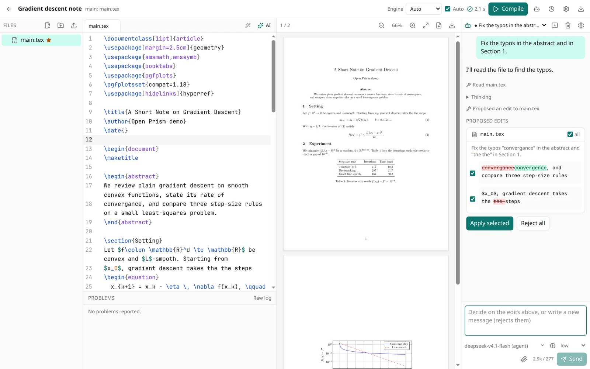
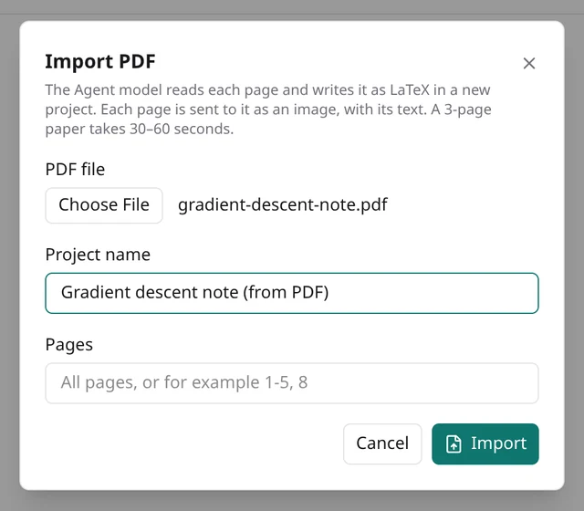
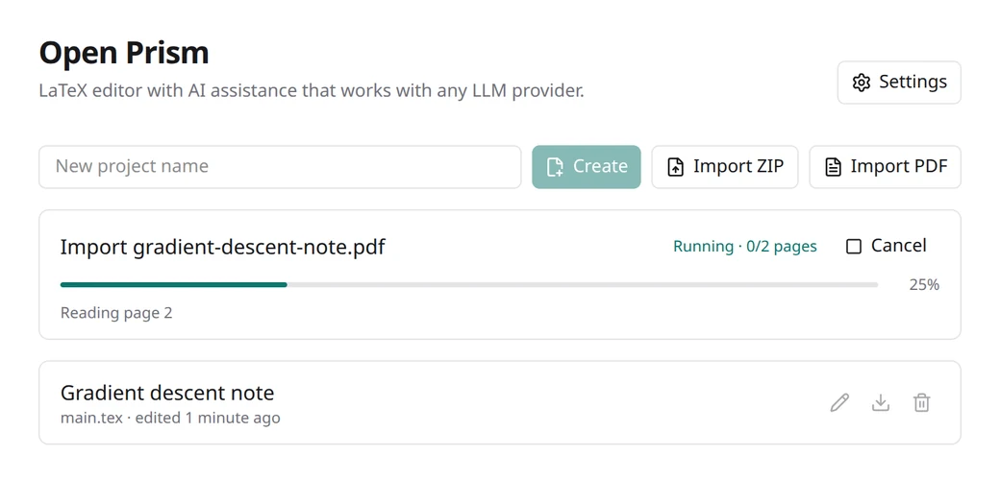
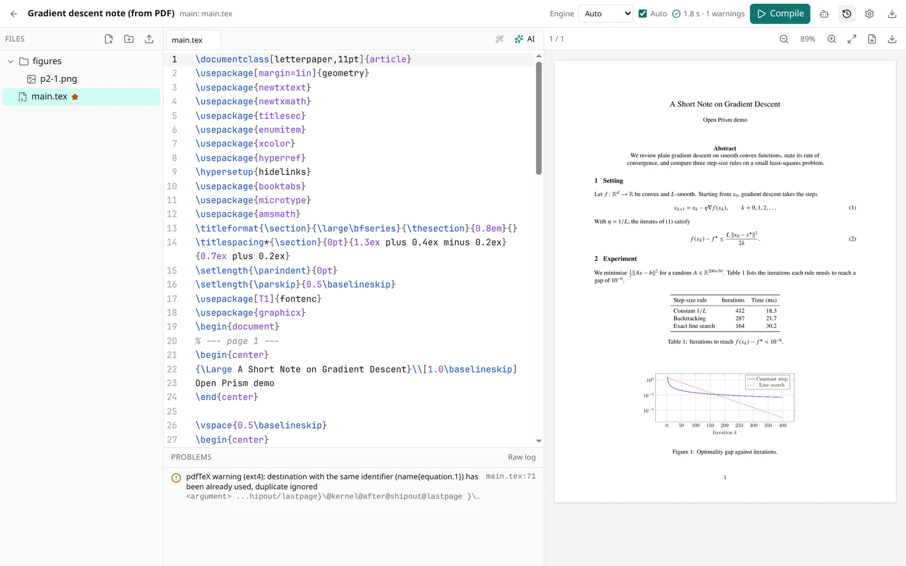
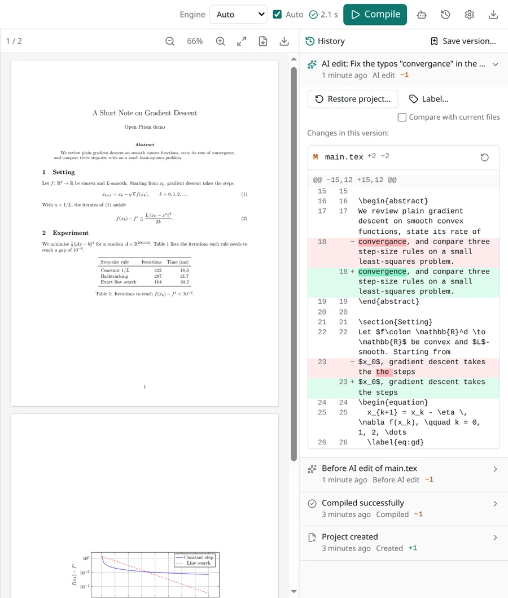
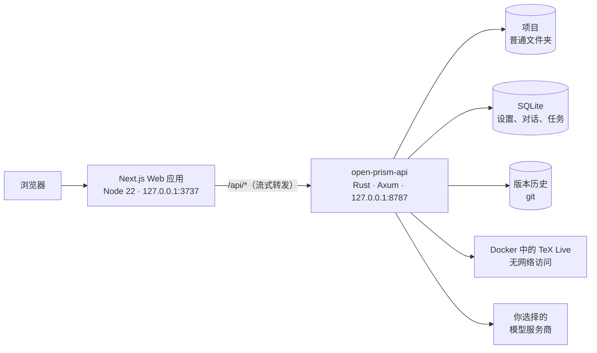

<div align="center">


# Open Prism

**开源的 AI 辅助 LaTeX 编辑器。<br>可接入任意大语言模型，所有数据都留在你自己的电脑上。**

[](https://github.com/nttung245/open-prism/actions/workflows/ci.yml)
[](https://github.com/nttung245/open-prism/releases)
[](https://github.com/nttung245/open-prism/pkgs/container/open-prism)
[](LICENSE)

[English](README.md) · [Tiếng Việt](README.vi.md) · **简体中文**

[快速开始](#快速开始) · [功能](#功能) · [工作原理](#工作原理) · [隐私](#隐私与安全) · [文档](#文档) · [路线图](#路线图)



</div>

## 为什么需要 Open Prism

OpenAI 的 AI LaTeX 写作环境 OpenAI Prism 将于 **2027 年 1 月 1 日**停止服务。Open Prism
是一个由你自己运行的开源替代品：

- **模型由你选择。** 支持 OpenAI、Anthropic、Gemini、DeepSeek、Mistral、OpenRouter、Groq、xAI
  和 OpenCode Go，也支持通过 Ollama、vLLM、LM Studio 和 llama.cpp 运行的本地模型。
- **文件始终属于你。** 每个项目都是磁盘上一个普通的 `.tex` 文件夹，应用只监听 `127.0.0.1`。
  除了发往你所选模型服务商的请求，没有任何数据离开你的电脑。
- **AI 提议，你来决定。** 每处修改都以 diff 的形式呈现，由你接受或拒绝。在你做出决定之前不会
  写入任何内容，每次修改都会记入可以回滚的版本历史。
- **轻松迁移已有项目。** 可以导入 Prism、Overleaf 和 arXiv 导出的 ZIP，也能把任意 PDF（包括
  扫描件）转换成可编辑的 LaTeX 项目。

## 功能

### 编写与编译

三栏工作区：文件树、LaTeX 编辑器和实时更新的 PDF 预览。

- **编译**：使用 latexmk（自动选择 pdfLaTeX、XeLaTeX 或 LuaLaTeX）或 Tectonic，按
  `Ctrl+Enter` 编译，或在每次保存后自动编译。错误和警告会显示在编辑器和 Problems 列表中。
- **双向 SyncTeX**：点击 PDF 跳转到对应源码，或按 `Ctrl+Alt+→` 在 PDF 中定位当前行。
- **导出**：将项目下载为 ZIP 或 7z，下载完整 PDF，或只下载部分页面（例如 `3-7, 10`）。

### 像细心的合著者一样工作的助手

- **带工具的 Agent。** 助手会读取你的项目（文件、搜索、大纲、编译日志），并以逐词 diff 的形式
  **提出**修改。已接受的修改会进入编辑器，因此可以用 `Ctrl+Z` 撤销。
- **Fix with AI。** 在 Problems 列表中，助手会循环执行“编译 → 修复 → 编译”，直到错误消失。
- **快捷操作**：对选中文本进行改写、精简、语法修正、翻译、解释，或执行你的自定义指令。
- **输入时的补全建议。** 句子的剩余部分、下一个 `\item` 或缺失的 `\end{…}` 会以灰色显示在
  光标处，按 `Tab` 接受。
- **截取并提问。** 在 PDF 中框选公式、表格或图片，直接就它提问。
- **图片转 LaTeX。** 粘贴公式、表格或手写内容的图片，即可得到适合当前位置的 LaTeX。
- **引用由你掌控。** 助手只帮助润色措辞和语法，从不自动添加 `\cite` 命令，也不会替你检索文献。

### 把任意 PDF 转换成 LaTeX 项目

<table>
  <tr>
    <td width="40%"></td>
    <td width="60%"></td>
  </tr>
</table>

**Import PDF** 让模型以图片形式阅读每一页，并在 PDF 带有文字层时一并参考，然后用 LaTeX 重建
文档：

- **版式**：生成与原文一致的导言区（纸张大小、页边距、字体、标题样式），并重建公式、表格和
  列表。
- **图片**会从页面中裁剪出来，保存到 `figures/`。
- **编译错误**会在你打开结果之前由助手修复。
- **后台任务**：导入过程中你可以继续处理其他项目，关闭页面甚至重启后也会继续。实时进度条会随
  每一页完成而更新。



### 每一次修改都有保障



**版本历史**会在以下时机保存版本：项目创建或导入时、每次 AI 修改前后、编译成功后，以及你随时
手动保存时。

- **对比**：每个版本都有逐行 diff，也可以与当前文件对比。
- **恢复**单个文件或整个项目。恢复前会先保存当前文件，所以恢复操作本身也能撤销。
- **基于 git 存储**：历史记录是项目旁边的一个普通 git 仓库，永远不会混进你导出的文件。

<br clear="right">

## 快速开始

Open Prism 运行在你自己的电脑上。选择一种安装方式：

| 你的环境 | 安装方式 | 需要准备 |
|---|---|---|
| Linux（x64 或 arm64） | [预构建安装包](#linux预构建安装包) | Docker，用于运行 TeX Live |
| macOS、Windows 或 Linux | [Docker 镜像](#dockermacoswindowslinux) | Docker Desktop 或 Docker |
| 已有开发工具链的电脑 | [从源码构建](#从源码构建) | Rust、Node.js 22、pnpm、just、Docker |

### Linux：预构建安装包

从 [Releases](https://github.com/nttung245/open-prism/releases) 下载
`open-prism-<version>-linux-x64.tar.gz`（或 `-arm64`），然后运行：

```sh
docker pull texlive/texlive:latest   # TeX Live，只需一次：约 2.6 GB 下载
tar -xzf open-prism-<version>-linux-x64.tar.gz
cd open-prism-<version>-linux-x64
./open-prism                         # 启动 Open Prism 并打开登录页面
```

### Docker：macOS、Windows、Linux

把 [`compose.yaml`](compose.yaml) 保存到一个文件夹，然后在该文件夹中运行：

```sh
docker compose up -d              # 首次运行会下载镜像，然后启动 Open Prism
docker compose logs open-prism    # 显示登录链接
```

镜像包含全部依赖（含 TeX Live），支持 amd64 和 arm64（包括 Apple Silicon）。

### 从源码构建

```sh
git clone https://github.com/nttung245/open-prism.git && cd open-prism
just tex-pull   # 以 Docker 镜像形式获取 TeX Live，只需一次
just build      # 构建 API 和 Web 应用的发布版本
just start      # 同时运行两者，并打印登录链接
```

### 连接模型

1. 在项目列表中打开 **Settings**。在 **Add a provider** 下选择类型，粘贴 API 密钥，然后点击
   **Add provider**。如何获取密钥或使用本地模型，请参阅（英文）
   [AI providers](README.md#ai-providers)。
2. 点击 **Test connection**，列出该服务商的可用模型。
3. 在 **Models** 下为 **Agent**（助手）选择模型；如有需要，再为 **Fast**（快捷操作、补全
   建议、图片转 LaTeX）选择一个更快的模型。点击 **Save models**。
4. 新建项目，按 `Ctrl+Enter` 编译，然后点击机器人按钮打开助手。

安装细节（校验下载文件、添加到应用菜单、修改端口、备份）请参阅（英文）
[Installation in depth](README.md#installation-in-depth)。

## 工作原理



| 层 | 技术 |
|---|---|
| 后端 | Rust、Axum、Tokio、SQLite（sqlx）、libgit2、用于对接各大模型服务商的 [genai](https://github.com/jeremychone/rust-genai)，以及用于渲染 PDF 页面和读取文字的 hayro 与 lopdf |
| 前端 | Next.js 16、React 19、TypeScript、CodeMirror 6、pdf.js、TanStack Query、Tailwind CSS 4 |
| TeX | 官方 TeX Live 镜像、latexmk 和 SyncTeX；也可使用 Tectonic 或本机安装的 TeX Live |
| 质量保障 | Rust 与 TypeScript 单元测试、在 Chromium 中针对模拟模型运行的端到端测试、clippy、Biome 和 cargo-deny，每个 pull request 都会在 CI 中运行；发布版本附带可验证的构建来源证明 |

- **单一入口。** Rust API 只监听 `127.0.0.1`。Next.js 服务器负责提供页面，并通过流式路由把
  `/api/*` 转发给 API。
- **后台任务。** PDF 导入等耗时工作按步骤执行，状态保存在数据库中，因此任务因重启而中断后会从
  中断处继续。
- **公平使用模型。** 后台请求经过一个共享闸门：每个服务商最多同时三个请求，遇到限流时自动
  等待。因此聊天和补全建议永远不会排在后台任务之后。

## 隐私与安全

- **仅限本机。** API 监听 `127.0.0.1`，Web 应用也是如此；在 Docker 镜像中运行时，端口只发布
  在宿主机的 `127.0.0.1` 上。登录使用首次启动时生成的随机访问令牌。
- **服务商只会收到各项功能所需的内容：**
  - 你的消息及其附带的图片；
  - 助手读取的文件和编译日志；
  - 快捷操作所选中的文本，以及补全建议所需的光标附近文字；
  - 导入 PDF 时，每一页的图片及其文字层。
- **API 密钥**保存在本地数据库中，绝不会回传给浏览器。
- **编译**在一次性、无网络访问的容器中进行。
- **发布版本**附带 SHA-256 校验和与 GitHub 构建来源证明，安装包和 Docker 镜像都有。

## 项目状态

早期版本（0.3.x）：
- 每个版本都会发布 Linux 预构建安装包和多架构 Docker 镜像。
- macOS 和 Windows 通过 Docker 运行，尚未在这两个系统上测试原生构建。
- 请参阅[路线图](#路线图)和[发布版本](https://github.com/nttung245/open-prism/releases)。

## 文档

详细文档目前只有英文版：

- [Installation in depth](README.md#installation-in-depth)：深入安装说明、校验下载文件、
  Docker、备份
- [Server mode](README.md#server-mode)：在共享服务器上为整个团队运行一个 Open Prism，
  包括账号、项目成员和共享的 AI 服务商
- [Feature reference](README.md#feature-reference)：每项功能的完整说明
- [AI providers](README.md#ai-providers)：获取 API 密钥、角色与推理强度、本地模型
- [Troubleshooting](README.md#troubleshooting)：故障排查、数据存放位置
- [Configuration](README.md#configuration)：环境变量和命令行参数
- [Development](README.md#development)：开发、测试和发布流程

## 路线图

- [x] **M0 项目搭建**：工作区、API 骨架、访问令牌登录、API 代理、CI
- [x] **M1 编辑器与编译**：项目管理、ZIP 导入导出、CodeMirror 编辑器、latexmk/Tectonic 编译、
      错误列表、PDF 预览、SyncTeX
- [x] **M2 AI**：服务商设置、带项目上下文的聊天、需审核的修改、“修复编译错误”、为不支持工具调用
      的模型提供的后备方案
- [x] **M3 写作辅助**：版本历史、输入时的补全建议、截取 PDF 并提问、聊天中的图片、图片与手写
      内容转 LaTeX
- [x] **M4 发布**：一条命令启动、用户文档、Linux 预构建安装包、Docker 镜像
- [x] **PDF 导入**：后台任务，以及由 Agent 逐页阅读、把 PDF（包括扫描件）导入为 LaTeX 项目
- [x] **服务器模式**：为整个团队运行一个 Open Prism，包括账号、项目成员，以及共享和个人的
      AI 服务商
- [ ] **草稿**：每人一份项目草稿，可从他人的草稿中取用部分内容，并提交由项目所有者审核的合并请求

## 参与贡献

欢迎提交 issue 和 pull request。
- **提交 pull request 前**，请运行 `just lint` 和 `just test`；如果修改了 Web 应用，请再运行
  `just e2e`。
- **提交信息**遵循 [Conventional Commits](https://www.conventionalcommits.org/) 规范，例如
  `feat(web): …` 或 `fix(server): …`。
- **每个 pull request** 都会在 CI 中运行相同的检查：Rust、Web、E2E 和 cargo-deny。

## 许可证

[Apache License 2.0](LICENSE)。第三方声明见 [NOTICE](NOTICE)。
